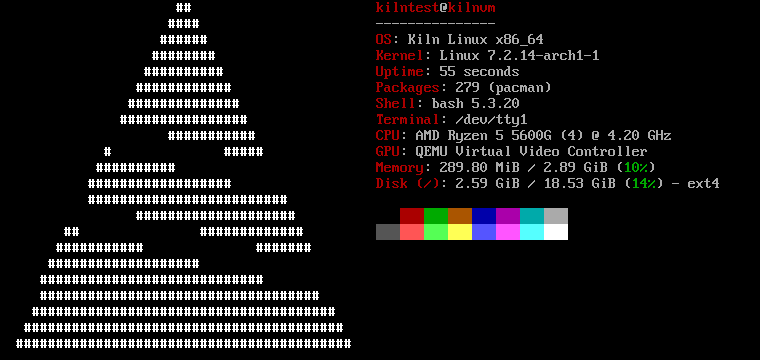

Kiln Linux is a small distribution built on Arch Linux. You keep Arch's repositories, pacman and systemd as they are. Kiln adds three things on top: a live ISO with a menu-driven installer, a choice of seven desktops with [twmx](https://github.com/arcbaseproject/twmx) as the default, and `kiln`, a tool that keeps your package sets in TOML files.

The screenshot comes from a test install in QEMU with the default twmx desktop. It shows 279 packages and 290 MiB of memory in use at the login console.

| Component | Choice |
| --- | --- |
| Base | Arch Linux: official repositories, pacman |
| Init | systemd |
| Desktop | twmx on X11 by default; i3, Sway, Hyprland, XFCE, KDE Plasma, GNOME, or none |
| Login | window managers start when you log in on tty1; XFCE, Plasma and GNOME get a login screen |
| Network | NetworkManager on the installed system; systemd-networkd and iwd on the live ISO |
| Audio | PipeWire, optional |
| Boot | systemd-boot, GRUB or Limine; UEFI and BIOS |

An installed Kiln system is an Arch system. The [Arch wiki](https://wiki.archlinux.org/) applies to it, and `sudo pacman -Syu` updates it.

:::caution[Beta]
Download the ISO from [kilnlinux.org/download](https://kilnlinux.org/download), or build it yourself from [the repository](https://github.com/kilnlinux/Kiln-Linux). Installs pass in QEMU on UEFI and BIOS, and the live ISO has booted on a real PC, but nobody has installed on real hardware yet. [Status](./status/) lists what has and hasn't been tried.
:::

## Where to go

- [Status and roadmap](./status/): what works, what nobody has tried yet, what's missing.
- [Installation](./installation/): build the ISO, boot it, run the installer.
- [Desktops](./desktops/): the seven choices, twmx keys, switching later.
- [Configuration](./configuration/): services, autostart, keyboard layouts, the boot loader.
- [Package management](./package-management/): pacman, `kiln` and profiles.
- [Troubleshooting](./troubleshooting/): known problems and their fixes.
- [Development](./development/) and [Contributing](./contributing/): how Kiln is built, and how to help.
